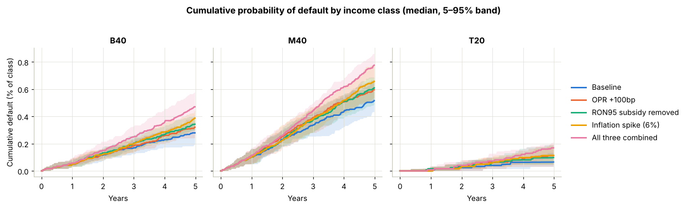
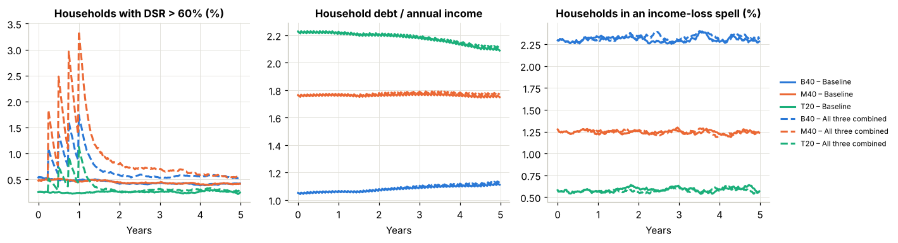
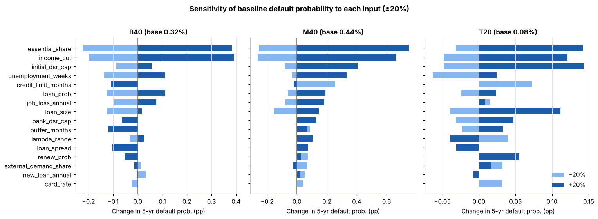

# Modelling Debt Risk on Different Income Levels Using Econophysics

Final year project, Department of Physics, Faculty of Science, Universiti Malaya.

## Research question
How does the probability of household debt default differ between Malaysian income groups (B40, M40, T20) over 2025–2030? How sensitive is each group to monetary, fiscal and price shocks?

## Approach
This is an **open-bath bipartite kinetic exchange model**, an extension of the Chakraborti–Chakrabarti saving-propensity model from statistical physics. Households trade with firms the way gas particles exchange energy in collisions, except that each household keeps a fraction λ of its wealth. The system is "open": wages, external demand, new credit, loan repayments and profits flow in and out of a reservoir (the "bath") that represents the wider economy. Each scenario is run many times (Monte Carlo) to estimate default probabilities with uncertainty bands.

On top of the exchange, each household has:
- **an income** drawn from DOSM HIES 2022, with random **job-loss spells**. Workers at failing firms face a higher risk, so firm distress spreads to households.
- **real loans** (mortgage, hire purchase, personal) with balances. Floating rates follow the OPR.
- **new borrowing**: renewals, first-time loans and overdraft refinancing, all subject to a bank DSR cap of 60%.
- **a bank-style default rule**: 13 weeks (~90 days) with the credit line exhausted.

Shock scenarios, compared against a baseline (OPR 2.75%, CPI 2%, wage growth 3%):

| Scenario | What changes |
|---|---|
| **OPR hike** | Four 25 bp hikes in the first year, from 2.75% to 3.75% |
| **RON95 subsidy removal** | Fuel cost × 2.60/1.99 from month 6, plus one year of extra CPI |
| **Inflation spike** | CPI at 6% for two years |
| **Combined** | All three together |
| *Recession (optional)* | Double job-loss risk and zero wage growth for 18 months |

## Preliminary results
30,000 households, 20 seeds, 5-year horizon after a 26-week warm-up:

| 5-year probability of default | B40 | M40 | T20 |
|---|---|---|---|
| Baseline | 0.28% | 0.53% | 0.08% |
| OPR +100 bp | 0.32% | 0.60% | 0.11% |
| RON95 subsidy removed | 0.35% | 0.61% | 0.11% |
| Inflation spike | 0.37% | 0.66% | 0.11% |
| All three combined | 0.48% | 0.78% | 0.15% |
| *Relative increase, combined vs baseline* | *+67%* | *+46%* | *+89%\** |

| Average share of households in overdraft | B40 | M40 | T20 |
|---|---|---|---|
| Baseline | 0.53% | 0.52% | 0.05% |
| All three combined | 0.90% | 1.07% | 0.08% |

\* T20 defaults are so rare that its relative change is mostly noise.



What the model currently says:
- Every shock raises both overdraft stress and default risk.
- Inflation hurts more than the OPR hike or the subsidy removal on its own.
- M40 has the highest default level; B40 reacts most sharply to the combined shock.

Each OPR hike briefly pushes more households above a 60% debt-service ratio, which then eases as they refinance:



**These numbers depend on placeholder parameters** (see Status) and are not yet thesis results.

## Which inputs matter most
Each placeholder was moved ±20% while everything else stayed fixed. Living-cost shares, the income lost in a job-loss spell, and the starting DSR cap drive the results most, so they are the first to replace with real data. Bars smaller than about ±0.1 percentage points are within Monte Carlo noise.



## Run it
**Google Colab:** open `notebooks/FYP_debt_risk_simulator.ipynb` in Colab (File → Open notebook → GitHub), then `Runtime → Run all`. It takes about 5 minutes with the defaults (30,000 households, 20 seeds, plus the sensitivity analysis). Set `FULL_SIZE = True` for 120,000 households.

**Locally:**
```bash
pip install -r requirements.txt
python tests/test_model.py          # 10 sanity checks, ~10 seconds
```
```python
import sys; sys.path.insert(0, "src")
from kinetic_debt_model import monte_carlo, sensitivity, SCENARIOS
results = monte_carlo(SCENARIOS, n_seeds=10, weeks=260)
```

## Sanity checks
`tests/test_model.py` (also run at the top of the notebook) checks that:
- loans amortise to exactly zero at maturity
- money is conserved every week (households + firms + bath ledger)
- there are no NaN or infinite values
- class mean incomes are within 5% of DOSM 2022
- every shock raises overdraft stress, and the combined shock raises default risk
- an OPR hike raises floating-rate instalments

## Repository layout
| Path | Contents |
|---|---|
| `notebooks/FYP_debt_risk_simulator.ipynb` | Full pipeline: model, checks, DOSM calibration, scenarios, Monte Carlo, charts, sensitivity, validation helpers |
| `src/kinetic_debt_model.py` | The model engine on its own (same code as the notebook's first cell) |
| `tests/test_model.py` | Automated sanity checks (`pytest tests/` or `python tests/test_model.py`) |
| `docs/model-review-2026-11-12.md` | Issues found in v1, what v2 and v3 changed, known limitations |

## Status
⚠️ Living-cost shares, loan take-up and sizes, job-loss rates, saving propensities and the DSR caps are **placeholders**. They must be replaced with BNM / AKPK / DOSM / PERKESO data before the results are used in the thesis. The last section of the notebook lists each one and where to get the real value. The sensitivity chart shows which to chase first.

## Author
Alvin Joseph Albert, Department of Physics, Faculty of Science, Universiti Malaya.

## Key references
- Chakraborti, A., & Chakrabarti, B. K. (2000). Statistical mechanics of money: how saving propensity affects its distribution. *Eur. Phys. J. B*, 17, 167–170.
- Yakovenko, V. M., & Rosser, J. B. (2009). Colloquium: Statistical mechanics of money, wealth, and income. *Rev. Mod. Phys.*, 81, 1703.
- Department of Statistics Malaysia (2023). *Household Income Survey Report 2022*.
- Bank Negara Malaysia. *Financial Stability Review* (household sector).
